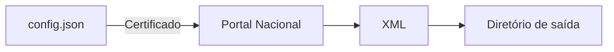

# Baixar NFS-e Portal Nacional

Ferramenta em **Python** para automatizar o download de documentos XML de Notas Fiscais de Serviço (NFS-e) pelo Ambiente de Dados Nacional (ADN).

[](https://github.com/USERNAME/baixar_nfse_portal_nacional/actions/workflows/build_exe.yml)
[](LICENSE)

## Baixe o executável

Sempre que mudanças são enviadas para o branch `main` o projeto gera
automaticamente um arquivo `exe` através do GitHub Actions. Você pode
obter a versão mais recente acessando a página de releases e baixando o
executável disponível.

[Download do instalador](https://github.com/USERNAME/baixar_nfse_portal_nacional/releases/latest)

## Visão geral

O projeto simplifica a obtenção de notas fiscais eletrônicas emitidas pelo Portal Nacional da NFS-e. Ideal para empresas e contadores que precisam manter o arquivo de notas organizado sem acessar manualmente o site.

### Principais recursos

- Baixa automaticamente XMLs de notas e eventos, mantendo os eventos em arquivos separados.
- Armazena logs e permite retomar o processo pelo último NSU.
- Utiliza certificado digital A1 em arquivo PFX/P12 para autenticação mútua TLS.
- Permite consultar filiais com o certificado da matriz, informando o CNPJ completo da filial.
- Permite selecionar produção ou produção restrita, com controle de NSU separado.
- Possui interface gráfica simples construída com `tkinter`.
- Suporte a criação de executável standalone via PyInstaller.

### Fluxo de funcionamento



## Instalação

1. Tenha o **Python 3.10** ou superior instalado.
2. (Opcional) Crie um ambiente virtual:

```bash
python3 -m venv .venv
source .venv/bin/activate  # Windows: .venv\Scripts\activate
```

3. Instale as dependências:

```bash
pip install -r requirements.txt
```

## Configuração

Edite o arquivo `config.json` (gerado automaticamente caso não exista) com as seguintes chaves:

- `cert_path`: caminho do certificado digital.
- `cert_pass`: senha do certificado.
- `cnpj`: CNPJ completo da empresa consultada, que pode ser diferente do CNPJ do certificado.
- `ambiente`: `producao` (padrão) ou `producao_restrita` (homologação/testes).
- `output_dir`: pasta onde os XMLs serão salvos.
- `log_dir`: diretório de logs.
- `file_prefix`: prefixo dos arquivos.
- `delay_seconds`: intervalo entre consultas.
- `auto_start`: inicia o download ao abrir.
- `timeout`: tempo limite das requisições.

## Uso

Execute o script principal:

```bash
python download_nfse.py
```

O programa abre a interface gráfica. Os arquivos são gravados seguindo o padrão `<prefixo>_AAAA-MM_<chave>.xml`.

Eventos e outros documentos usam o sufixo `_documento_<NSU>.xml` para preservar o XML da nota com a mesma chave. O download começa ao clicar em **Iniciar Download**, ou automaticamente se `auto_start` estiver habilitado.

### Certificado da matriz e filiais

Selecione o certificado da matriz em `cert_path` e informe o CNPJ completo da filial em `cnpj`. O programa envia esse valor em `cnpjConsulta`, com `lote=true`, na chamada `GET /DFe/{NSU}`. A autorização é verificada pela API: CNPJs com a mesma raiz (oito primeiros caracteres) podem consultar sem procuração, conforme o [manual oficial do ADN](https://www.gov.br/nfse/pt-br/biblioteca/documentacao-tecnica/documentacao-atual/manual-contribuintes-apis-adn-sistema-nacional-nfse.pdf). Cada estabelecimento mantém seu próprio NSU; configurar uma filial não consulta automaticamente todas as demais.

O Swagger anexado à revisão também documenta consultas de outra raiz mediante procuração válida, com rejeição `E2245` quando ausente. O programa não impede essa autorização no cliente nem presume que ela exista. A Receita Federal é responsável por validar a permissão e os dígitos verificadores do CNPJ.

### Download de PDF

A API DANFSe v1 foi desativada em **3 de agosto de 2026**, segundo o [histórico oficial de implantações](https://www.gov.br/nfse/pt-br/biblioteca/documentacao-tecnica/atualizacoes-e-implantacoes/atualizacoes-e-implantacoes). Por isso, o download automático e a opção **Baixar PDF** foram removidos. Configurações antigas com `download_pdf` continuam sendo lidas; o campo é descartado ao salvar.

O DANFSe continua disponível nos portais oficiais, como a Consulta Pública. A geração pelo próprio sistema requer implementar o leiaute da NT 008; esta ferramenta mantém o download dos XMLs e não implementa essa geração local.

### Retomada e rejeições

O arquivo `ultimo_nsu_<CNPJ>.txt` guarda o **próximo NSU** a consultar. O programa envia o valor anterior, pois o NSU da distribuição em lote é exclusivo. O arquivo de produção existente é preservado; produção restrita usa `ultimo_nsu_<CNPJ>_producao_restrita.txt`. Use diretórios de saída distintos caso mantenha arquivos dos dois ambientes.

HTTP 400 preserva o NSU e exibe a resposta completa, com `Codigo`, `Descricao` e `Complemento` quando fornecidos. Rejeições com `Erros: []` também interrompem o processo, sem anunciar sucesso. Respostas 404 com `E2220`/`E2230` são tratadas como fim da distribuição; outros erros 404 continuam visíveis.

### Verificação da revisão de novembro de 2026

Consulte [a análise técnica e suas limitações](docs/revisao_api_adn.md). O Swagger fornecido foi comparado com o código e com as publicações oficiais acessíveis; não foi possível obter o Swagger online para confirmar igualdade com a revisão publicada no servidor.

Os testes de integração da correção usam `requests` e `cryptography` reais, com o transporte HTTP simulado:

```bash
python -m unittest discover -s tests -p test_adn_api.py -v
```

Esses testes não acessam a API nem comprovam a autorização de um certificado ICP-Brasil real.

## Contribuição

Contribuições são bem-vindas! Abra issues ou pull requests com melhorias, correções ou novas funcionalidades. Para mudanças maiores, discuta previamente através de uma issue.

## Licença

Distribuído sob a licença [MIT](LICENSE).

## Contato

Para dúvidas ou suporte abra uma issue no GitHub ou contate **Renan R. Santos** através do [LinkedIn](https://www.linkedin.com/).

## Documentação online

Você pode publicar a pasta `docs/` via **GitHub Pages** para hospedar uma documentação completa em <https://USERNAME.github.io/baixar_nfse_portal_nacional/>.

## Dados estruturados

```html
<script type="application/ld+json">
{
  "@context": "https://schema.org",
  "@type": "SoftwareApplication",
  "name": "Baixar NFS-e Portal Nacional",
  "applicationCategory": "BusinessApplication",
  "operatingSystem": "Windows, Linux, macOS",
  "license": "https://opensource.org/licenses/MIT",
  "offers": {
    "@type": "Offer",
    "price": "0",
    "priceCurrency": "BRL"
  }
}
</script>
```

---

### Tópicos sugeridos

Adicione as seguintes *tags* ao repositório no GitHub para melhorar a descoberta:
`nfse`, `nfs-e`, `portal-nacional`, `download`, `python`, `automacao`, `xml`, `pdf`.

